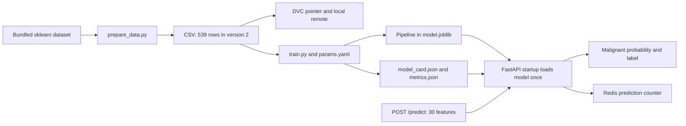

# Project walkthrough and manual commands in VS Code

This guide explains the implementation and how to run it yourself on this Windows
machine. All command blocks marked `powershell` belong in **VS Code → Terminal → New
Terminal**, with **PowerShell** selected. Do not paste them into the Python prompt,
Debug Console, Docker Desktop terminal, or a `.py` file.

You do not need to repeat repository initialization, image publishing, or the Docker
fundamentals exercises every time you run the application.

## 1. Open the correct folder and prepare your terminals

In VS Code, select **File → Open Folder** and open:

```text
E:\mlops ass 2\breast-cancer-triage-service
```

This is the **project root**: it contains `Dockerfile`, `dvc.yaml`, `params.yaml`,
`sample.json`, and `docker-compose.yml`. Most commands below must run here because
the application and DVC use paths relative to the current directory.

Use two PowerShell terminals when running the Python API:

| Terminal | Purpose | Starting directory |
|---|---|---|
| A | Setup, training, Docker, or the foreground Python API | Project root |
| B | HTTP requests while Terminal A runs the Python API | Project root |

**Run this setup block once in every new VS Code PowerShell terminal on this machine:**

```powershell
Set-Location -LiteralPath 'E:\mlops ass 2\breast-cancer-triage-service'
$ProjectRoot = (Get-Location).Path
$WorkspaceRoot = Split-Path -Parent $ProjectRoot
$LocalTools = Join-Path $WorkspaceRoot '.tools'
$PythonDirectory = Join-Path $LocalTools 'python'
$PythonScripts = Join-Path $PythonDirectory 'Scripts'
$GitDirectory = Join-Path $LocalTools 'git\cmd'
$env:Path = "$PythonDirectory;$PythonScripts;$GitDirectory;C:\Program Files\GitHub CLI;$env:Path"
$env:PYTHONUTF8 = '1'
$env:PYTHONDONTWRITEBYTECODE = '1'
$env:DVC_NO_ANALYTICS = 'true'
$env:DVC_SITE_CACHE_DIR = Join-Path $LocalTools 'dvc-site-cache'

Get-Location
python --version
git --version
dvc version
docker version
docker compose version
```

The existing `.tools/python` is a workspace-local Python installation with the
dependencies already installed. `.tools/git` supplies Git, which is not otherwise
on the normal terminal PATH. These are working tools, not leftover installers.
The PATH changes above apply only to the current terminal. DVC's disposable site
cache is recreated when needed.

Open **Docker Desktop** and wait for its Linux engine to start before Docker
commands. If it is stopped, you can also run `docker desktop start` and then check
`docker version` again. Both Client and Server sections should appear.

For VS Code's editor, use **Ctrl+Shift+P → Python: Select Interpreter → Enter
interpreter path** and select:

```text
E:\mlops ass 2\.tools\python\python.exe
```

Selecting the editor interpreter does not replace the terminal setup block above.
Do not try to create a virtual environment using this embedded Python installation.
For a different machine with a full Python installation, use section 15 instead.

### Ports used in this guide

| Run mode | Host URL | Why this port |
|---|---|---|
| Existing published Hub stack | http://localhost:8000 | Already configured in `../clean-room/.env` |
| Python API without Docker | http://localhost:8001 | Separate from the published stack |
| Standalone locally built container | http://localhost:18000 | Separate from both above |
| Container with changed settings | http://localhost:18001 | Allows side-by-side comparison |
| Local source Compose stack | http://localhost:18004 | Avoids colliding with the published stack |

These are alternatives you can compare. You do not need all of them running.

## 2. Understand the complete flow



The service does not train a model for each request. Training is a separate step.
At startup, FastAPI loads the already-trained pipeline and its model card. Each
valid prediction runs the pipeline once, optionally increments Redis, and returns
JSON. This is an educational screening-support exercise, not a medical device.

### Which files do what?

| File or directory | Responsibility |
|---|---|
| `training/prepare_data.py` | Export the bundled dataset; validate 30 features and no nulls; optionally remove the final 30 rows |
| `training/train.py` | Split, cross-validate, select, evaluate, enforce the recall gate, and serialize the model |
| `params.yaml` | Seed 42, split size, CV folds, model version, and model hyperparameters |
| `data/raw/breast_cancer.csv` | Restored working dataset; ignored by Git |
| `data/raw/breast_cancer.csv.dvc` | Small dataset pointer committed to Git |
| `.dvc/config` | Default local remote configuration |
| `dvc-remote/` | Content-addressed objects for both dataset versions and the submitted model outputs; intentionally committed for this assignment |
| `dvc.yaml` | Training command, dependencies, parameters, outputs, and metrics |
| `dvc.lock` | Recorded hashes and parameter values from the last pipeline run |
| `artifacts/model.joblib` | Serialized preprocessing + estimator pipeline; ignored by Git |
| `artifacts/model_card.json` | Model identity, feature order, seed, software version, and evaluation metrics |
| `metrics.json` | Candidate CV/test metrics and selected model name |
| `app/main.py` | Startup loading, input validation, prediction, health, metadata, and Redis counting |
| `app/server.py` | Uvicorn launcher; directs server log streams to stdout |
| `requirements-train.txt` | Pinned training dependencies |
| `requirements-serve.txt` | Pinned serving dependencies; matches training's scikit-learn version |
| `requirements-dev.txt` | DVC, tests, and screenshot/report tools |
| `Dockerfile.naive` | Required Ubuntu baseline for the assignment comparison |
| `Dockerfile` | Production multi-stage image |
| `.dockerignore` | Exclude Git, caches, reports, scripts, etc. from image builds; retain the training CSV |
| `docker-compose.yml` | Build local API source and run it alongside Redis |
| `docker-compose.hub.yml` | Run the published image without a build section |
| `.env.example` / `.env` | Documented settings template / ignored local configuration |
| `sample.json` | One valid 30-feature request body |
| `tests/test_api.py` | Nine tests covering predictions, validation, outage handling, thresholds, and missing artifacts |
| `scripts/probe_api.py` | Verify a running HTTP API; expects model version 1.0.0 |
| `scripts/milestone*.py` | Historical assignment automation, including commits and container lifecycle actions |
| `scripts/direct_*.py`, `capture_*.py` | Original Windows terminal and real browser screenshot capture |
| `scripts/make_report.py` | Assemble saved original screenshots, tables, and analysis into the PDF |
| `scripts/publish_verify.py`, `cleanroom_live.py`, `evidence.py` | Publication/clean-room evidence workflows and command recording |
| `evidence/` | Measurements, execution records, publication details, and original screenshots |

The historical milestone scripts are **not** normal application launch scripts.
Some create Git commits, change dataset pointers, or remove test containers. Use
the individual commands in this guide for manual work.

## 3. Restore the data and inspect DVC

**Where:** Terminal A, project root, after section 1.

```powershell
dvc remote list
dvc pull
dvc status
Get-Content data/raw/breast_cancer.csv.dvc
git ls-files data/raw
git check-ignore data/raw/breast_cancer.csv
python -c "import pandas as pd; d=pd.read_csv('data/raw/breast_cancer.csv'); print('Rows:',len(d),'Features:',len(d.columns)-1,'Nulls:',d.isna().sum().sum())"
```

Expect **539 rows, 30 features, and 0 nulls**. Git tracks the `.dvc` pointer, not the
working CSV. `dvc pull` restores objects from the committed `dvc-remote/`; no cloud
storage credentials are required. The remote path is relative to `.dvc/config`, so
its `../dvc-remote` value refers to the project-root directory.

There are two intentional versions:

- `data-v1`: all 569 original samples.
- `data-v2`: final 30 rows removed, leaving 539 samples. Later milestones use this.

**Optional version-switch demonstration, same terminal and directory:**

```powershell
git checkout data-v1 -- data/raw/breast_cancer.csv.dvc
dvc pull data/raw/breast_cancer.csv.dvc
dvc checkout data/raw/breast_cancer.csv.dvc
python -c "import pandas as pd; print(len(pd.read_csv('data/raw/breast_cancer.csv')))"

git checkout data-v2 -- data/raw/breast_cancer.csv.dvc
dvc pull data/raw/breast_cancer.csv.dvc
dvc checkout data/raw/breast_cancer.csv.dvc
python -c "import pandas as pd; print(len(pd.read_csv('data/raw/breast_cancer.csv')))"
git status --short
```

The first count is 569 and the second 539. Restore v2 before training. These Git
commands switch only the pointer file, not the entire source branch.
The targeted pull also fetches that version if a fresh clone has not cached it yet.

`prepare_data.py` originally created the CSV with:

```powershell
python -m training.prepare_data --version 1
# Or, for the required corrected export:
python -m training.prepare_data --version 2
```

Those commands **overwrite the working CSV**. Use `dvc pull` for ordinary setup.
If you intentionally regenerate v2, run `dvc status` to check its hash. For genuinely
new data, use `dvc add data/raw/breast_cancer.csv` and `dvc push`, then review and commit
the updated pointer and remote objects.

## 4. Train the model and understand its selection

**Where:** Terminal A, project root, with v2 restored.

```powershell
dvc repro
Get-Content metrics.json
Get-Content artifacts/model_card.json
```

If restored outputs are already current, DVC correctly skips training. To actually
execute training again while updating the pipeline record:

```powershell
dvc repro --force
```

Or invoke the training program directly when inspecting its arguments:

```powershell
python -m training.train --data-path data/raw/breast_cancer.csv --output-dir artifacts --model-version 1.0.0
```

Prefer `dvc repro` for tracked changes: invoking Python directly does not itself
update `dvc.lock`.

The implementation performs these steps:

1. Read the CSV and `params.yaml`; reject a seed other than 42.
2. Create a stratified 80/20 split: 431 training rows and 108 test rows for v2.
3. Construct logistic-regression and random-forest pipelines. Each includes a
   `StandardScaler`; scaling is important for logistic regression and harmless for
   the forest. Keeping it inside the pipeline also prevents preprocessing leakage
   across CV folds.
4. Run shuffled five-fold stratified CV on the training split, with seed 42.
5. Select the highest mean **malignant-class recall**, before examining test scores.
6. Fit both candidates and report held-out recall, accuracy, and ROC AUC.
7. Exit with an error if the selected model's test malignant recall is below 0.95.
8. Save the selected pipeline, model card, and metrics.

Dataset class **0 means malignant**, class **1 means benign**. Recall uses
`pos_label=0`; ROC AUC uses the probability column belonging to class 0. The API
also locates that column using `model.classes_`, rather than assuming class 1 is
the positive class.

The submitted logistic-regression model achieved test malignant recall **0.97561**,
accuracy **0.97222**, and ROC AUC **0.99563**. Training took roughly 1–3 seconds in
the recorded runs. Metrics are measured at the default threshold 0.5.

### Observe DVC's skip and rerun behavior

**Where:** Terminal A, project root. Start with no personal edits to `params.yaml`.

```powershell
dvc repro
dvc repro
```

Both may skip if nothing changed. In VS Code, open `params.yaml` and change
`forest.n_estimators` from `160` to `161`, save, then run:

```powershell
dvc repro
git diff -- params.yaml dvc.lock metrics.json
```

The parameter change invalidates the training stage. To return to the submitted
configuration, manually change 161 back to 160, save, and run:

```powershell
dvc repro
dvc status
```

For an intentional experiment you want to keep, run `dvc push`, then review
`params.yaml`, `dvc.lock`, `metrics.json`, and `dvc-remote/` before committing.

## 5. Run and call the Python API without Docker

**Where:** Terminal A, project root. Keep this terminal occupied by the server.

```powershell
Remove-Item Env:REDIS_HOST -ErrorAction SilentlyContinue
Remove-Item Env:MODEL_VERSION -ErrorAction SilentlyContinue
Remove-Item Env:GIT_SHA -ErrorAction SilentlyContinue
$env:MODEL_PATH = 'artifacts/model.joblib'
$env:DECISION_THRESHOLD = '0.5'
$env:LOG_LEVEL = 'INFO'
python -m app.server --host 127.0.0.1 --port 8001
```

You should see successful startup and `Uvicorn running on http://127.0.0.1:8001`.
Leave Terminal A running. Stop it with **Ctrl+C** when finished.
After retraining, stop and restart this Python server to load the new artifact.
For Docker deployments, rebuild the image and recreate its container: the image's
training stage produces its own artifact from the restored CSV and parameters.

**Where:** Terminal B, project root, after repeating section 1's terminal setup.

```powershell
Invoke-RestMethod http://localhost:8001/health
Invoke-RestMethod http://localhost:8001/model/info | ConvertTo-Json -Depth 8
Invoke-RestMethod -Uri http://localhost:8001/predict -Method Post -ContentType 'application/json' -InFile sample.json
Invoke-RestMethod http://localhost:8001/stats
python scripts/probe_api.py --url http://localhost:8001
```

The sample should be labeled `malignant`, with probability approximately
`0.999999986`. Without Redis, `/stats` returns an explicit disabled state; its zero
is not a count of standalone predictions.

Open **http://localhost:8001/docs** in your browser. Expand **POST /predict**, choose
**Try it out**, paste the contents of `sample.json`, and select **Execute**. Swagger
shows the request, generated curl command, status code, and response.

### What happens inside the API?

- The lifespan startup function reads environment settings, validates the threshold,
  loads `model.joblib` once, reads `model_card.json` beside it, and checks feature order.
- Pydantic requires exactly 30 named, finite, nonnegative numeric values. Missing or
  extra fields, negative values, booleans, and strings are rejected with 422.
- `/predict` orders the fields according to `FEATURES`, predicts the class-0
  probability, and labels it malignant when `probability >= threshold`.
- If `REDIS_HOST` is set, each successful prediction increments Redis's `predictions`
  key. Validation failures do not increment it. A Redis failure logs a warning and
  inference continues; the missed increment is not replayed later.
- `/health` does not call Redis. `/stats` returns 503 when configured Redis is
  unavailable. `/model/info` returns the model card plus effective runtime identity
  and threshold. Changing the threshold does not recompute the saved test metrics.

**Try invalid input in Terminal B:**

```powershell
try {
    Invoke-RestMethod -Uri http://localhost:8001/predict -Method Post -ContentType 'application/json' -Body '{}'
} catch {
    [int]$_.Exception.Response.StatusCode
}
```

Expected status: **422**. For the complete test suite, no running server is needed:

```powershell
python -m pytest -q -p no:cacheprovider tests
```

Expected: **9 passed**. These tests start FastAPI in-process and also check missing
model startup failure, a Redis outage, and threshold behavior.

## 6. Build and run the production Docker image

**Where:** Terminal A, project root. Stop a foreground Python server with Ctrl+C
first, or use another initialized PowerShell terminal.

```powershell
dvc pull
$BuildSha = git rev-parse HEAD
$DevImage = 'asad3390/breast-cancer-triage-api:manual-dev'
docker build --progress=plain --build-arg MODEL_VERSION=1.0.0 --build-arg "GIT_SHA=$BuildSha" -t $DevImage .
```

The final `.` is the build context: the current project folder. The `manual-dev`
tag keeps your experiments separate from the published `1.0.0` release. It still
reports model version 1.0.0 because the image tag and model version are independent.

The Dockerfile's **trainer stage** installs training dependencies, copies the
restored CSV and training code, and trains the model. Its **runtime stage** starts
from a pinned slim Python base, installs only serving dependencies, and copies the
artifacts plus application code. It has no project CSV, pandas, PyYAML, DVC, or Git.
It runs as UID 10001, exposes 8000, and checks `/health` with Python's standard library.
Dependencies are installed before application code is copied, allowing code-only
changes to reuse those dependency layers.

```powershell
docker run -d --name triage-manual -p 18000:8000 $DevImage
docker logs triage-manual
Start-Sleep -Seconds 10
docker inspect --format '{{.State.Health.Status}}' triage-manual
python scripts/probe_api.py --url http://localhost:18000
docker exec triage-manual id
docker history $DevImage
docker image inspect $DevImage
```

`18000:8000` forwards host port 18000 to the container's port 8000. The Docker server
binds to `0.0.0.0` inside the container so forwarded network traffic can reach it.
The exec-form entrypoint runs `python -m app.server`; CMD supplies default host/port
arguments. The non-root user, labels, exposed port, and healthcheck are visible in
image inspection. Health may initially be `starting`; check again after startup.

**Change settings without rebuilding, same terminal:**

```powershell
docker run -d --name triage-manual-config -p 18001:8000 -e DECISION_THRESHOLD=0.99 -e LOG_LEVEL=DEBUG $DevImage
Start-Sleep -Seconds 5
python scripts/probe_api.py --url http://localhost:18001 --threshold 0.99
docker logs triage-manual-config
```

**Stop and remove just these two demonstration containers when finished:**

```powershell
docker stop triage-manual triage-manual-config
docker rm triage-manual triage-manual-config
```

If you repeat this section, remove the old containers first; container names must
be unique. Keep `$DevImage` defined, or set it again in a new terminal.

## 7. Run the local source with Redis using Compose

**Where:** Terminal A, project root. Initialize the terminal as in section 1.

```powershell
if (-not (Test-Path .env)) { Copy-Item .env.example .env }
$env:API_PORT = '18004'
$env:IMAGE_TAG = 'manual-dev'
$env:GIT_SHA = git rev-parse HEAD
$env:DECISION_THRESHOLD = '0.5'
$env:LOG_LEVEL = 'INFO'
docker compose config
docker compose up -d --build --wait
docker compose ps
python scripts/probe_api.py --url http://localhost:18004
```

This uses the project name `mlops-a02`. The existing published stack is
`mlops-a02-hub`, so it is separate. We override the host port and image tag in this
terminal to avoid conflicting with the running published stack or its release tag.

Compose reads `.env` automatically; values in the current terminal environment take
precedence. These `$env:` assignments affect this terminal and its child commands,
not other VS Code terminals. Use the same settings for subsequent commands below.

Redis has no host port mapping. The API connects to hostname `redis` through the
Compose network. `depends_on: condition: service_healthy` delays API startup until
Redis passes `redis-cli ping`. Redis uses AOF persistence with `appendfsync always`
and the named volume `mlops-a02_redis-data`.

**Counter check, same terminal:**

```powershell
$Before = (Invoke-RestMethod http://localhost:18004/stats).predictions
1..3 | ForEach-Object {
    Invoke-RestMethod -Uri http://localhost:18004/predict -Method Post -ContentType 'application/json' -InFile sample.json
}
$After = (Invoke-RestMethod http://localhost:18004/stats).predictions
"Before: $Before; After: $After; Increase: $($After - $Before)"
```

Expect an increase of 3, assuming no other client sends predictions concurrently.

**Redis outage demonstration:**

```powershell
docker compose stop redis
Invoke-RestMethod http://localhost:18004/health
Invoke-RestMethod -Uri http://localhost:18004/predict -Method Post -ContentType 'application/json' -InFile sample.json
docker compose logs --tail 15 api
docker compose start redis
```

Health and prediction should succeed while Redis is stopped. `/stats` would return
503 during the outage, so do not use `probe_api.py` as the outage test: that helper
expects the stats endpoint to be available.

**Persistence demonstration:**

```powershell
$SavedCount = (Invoke-RestMethod http://localhost:18004/stats).predictions
docker compose down
docker compose up -d --wait
$RestoredCount = (Invoke-RestMethod http://localhost:18004/stats).predictions
"Before restart: $SavedCount; After restart: $RestoredCount"
```

The counts should match. `down` removes containers/network but retains the volume.
To demonstrate a deliberate reset of **this local Compose stack's counter**:

```powershell
docker compose down -v
docker compose up -d --wait
Invoke-RestMethod http://localhost:18004/stats
```

Expect zero before sending another prediction. `-v` deletes this project's Redis
data, so omit it during ordinary shutdown.

```powershell
docker compose logs --tail 20 api
docker compose logs --tail 20 redis
docker compose down
```

Before using the published stack in the same terminal, clear the overrides:

```powershell
Remove-Item Env:API_PORT, Env:IMAGE_TAG, Env:GIT_SHA -ErrorAction SilentlyContinue
```

## 8. Run the published Docker Hub image without building

**Where:** Terminal A, start in the project root; the first command moves into the
existing clean-room deployment directory. This folder is retained because it is
the configuration for the published stack, not an unused source copy.

```powershell
Remove-Item Env:API_PORT, Env:IMAGE_TAG, Env:GIT_SHA -ErrorAction SilentlyContinue
Set-Location -LiteralPath 'E:\mlops ass 2\clean-room'
Get-ChildItem -Force
docker compose -f docker-compose.hub.yml pull
docker compose -f docker-compose.hub.yml up -d --wait
docker compose -f docker-compose.hub.yml ps
Invoke-RestMethod http://localhost:8000/health
```

Only `.env` and `docker-compose.hub.yml` are needed in this folder. No Python, CSV,
model files, source code, or Dockerfile is needed to launch the published stack.
Open **http://localhost:8000/docs** to try predictions in the browser.

To run the supplied probe, return to the source root so `sample.json` is found:

```powershell
Set-Location -LiteralPath 'E:\mlops ass 2\breast-cancer-triage-service'
python scripts/probe_api.py --url http://localhost:8000
```

To stop this published stack, specify its Compose file explicitly:

```powershell
docker compose -f ../clean-room/docker-compose.hub.yml down
```

That command targets `mlops-a02-hub`, not the source stack `mlops-a02`.

## 9. Configuration reference

| Setting | Used by | Meaning |
|---|---|---|
| `MODEL_PATH` | API | Path to joblib file; the JSON model card must be beside it |
| `DECISION_THRESHOLD` | API | Malignant probability cutoff; 0–1, default 0.5 |
| `LOG_LEVEL` | API/server | Logging verbosity, default INFO; stdout only |
| `REDIS_HOST` | API | Unset disables counting; Compose sets service name `redis` |
| `REDIS_PORT` | API | Redis port, default 6379; match the actual server port |
| `MODEL_VERSION` | Docker build argument / API environment | Model release identity; default 1.0.0 |
| `GIT_SHA` | Docker build argument / API environment | Source commit recorded in labels and metadata |
| `DOCKERHUB_USERNAME` | Compose | Image namespace, `asad3390` |
| `IMAGE_TAG` | Compose | Image tag; use manual-dev for experiments, 1.0.0 for the release |
| `API_PORT` | Compose | Host port; container port remains 8000 |

An ordinary `python -m app.server` command does **not** automatically load `.env`.
Set `$env:...` values in that terminal. Compose performs its own `.env` interpolation.
Docker `ARG` values exist during build; the Dockerfile explicitly copies selected
ones into `ENV` and image labels for runtime use.

## 10. Reproduce the baseline and cache comparison manually

**Optional assignment task. Where:** Terminal A, project root. The baseline is not
needed to run production. `--no-cache` deliberately makes these builds slower.

```powershell
dvc pull
$BuildSha = git rev-parse HEAD
$BaselineSeconds = (Measure-Command {
    docker build --no-cache --progress=plain -f Dockerfile.naive --build-arg "GIT_SHA=$BuildSha" -t asad3390/breast-cancer-triage-api:naive .
}).TotalSeconds
if ($LASTEXITCODE -ne 0) { throw 'Baseline build failed' }
$ProductionSeconds = (Measure-Command {
    docker build --no-cache --progress=plain --build-arg MODEL_VERSION=1.0.0 --build-arg "GIT_SHA=$BuildSha" -t asad3390/breast-cancer-triage-api:manual-dev .
}).TotalSeconds
if ($LASTEXITCODE -ne 0) { throw 'Production build failed' }
"Baseline cold seconds: $BaselineSeconds; Production cold seconds: $ProductionSeconds"
docker image inspect --format 'Size={{.Size}} User={{.Config.User}}' asad3390/breast-cancer-triage-api:naive
docker image inspect --format 'Size={{.Size}} User={{.Config.User}}' asad3390/breast-cancer-triage-api:manual-dev
```

The baseline installs Python/pip and their OS dependencies in Ubuntu, copies the
project before installing Python dependencies, and trains in the same image. It
retains training packages and runs as root. The production stages separate training
from serving and retain only runtime content. An empty inspected user means root.

In VS Code, add a harmless comment to `app/main.py` and save. Then run:

```powershell
$BaselineRebuildSeconds = (Measure-Command {
    docker build --progress=plain -f Dockerfile.naive --build-arg "GIT_SHA=$BuildSha" -t asad3390/breast-cancer-triage-api:naive .
}).TotalSeconds
if ($LASTEXITCODE -ne 0) { throw 'Baseline rebuild failed' }
$ProductionRebuildSeconds = (Measure-Command {
    docker build --progress=plain --build-arg MODEL_VERSION=1.0.0 --build-arg "GIT_SHA=$BuildSha" -t asad3390/breast-cancer-triage-api:manual-dev .
}).TotalSeconds
if ($LASTEXITCODE -ne 0) { throw 'Production rebuild failed' }
"Baseline rebuild seconds: $BaselineRebuildSeconds; Production rebuild seconds: $ProductionRebuildSeconds"
```

Look for `CACHED` on the production dependency layers. Remove only your added
comment afterward. Keep the same build arguments between measurements; changing
`GIT_SHA` can invalidate the trainer stage. `--no-cache` skips build-layer reuse,
but does not promise an empty downloaded-base-image cache. Network and disk speed
affect timings. The historical measured comparison remains in
`evidence/build_comparison.json` and the assignment report.

## 11. Docker CLI fundamentals, if you want to repeat Milestone 0

**Optional. Where:** Terminal A, project root. Run each block separately. Commands
marked expected failure are deliberate assignment demonstrations. These use `walk-`
names to avoid touching the published API stack.

### First container

```powershell
docker version
docker run --rm hello-world:linux
docker run --rm hello-world:linux
```

If the tag is missing, the first run pulls it; the next reuses it. On this machine
it may already be cached, so both runs can omit the pull. `--rm` cleans up each
completed demonstration container.

### nginx lifecycle, conflicting ports, and logs

```powershell
docker run -d --name walk-nginx1 -p 18080:80 nginx:1.28.0-alpine
Start-Sleep -Seconds 2
(Invoke-WebRequest -UseBasicParsing http://localhost:18080).StatusCode
# Expected failure: host port 18080 is already allocated.
docker run -d --name walk-nginx-conflict -p 18080:80 nginx:1.28.0-alpine
docker rm walk-nginx-conflict
docker run -d --name walk-nginx2 -p 18081:80 nginx:1.28.0-alpine
1..3 | ForEach-Object { (Invoke-WebRequest -UseBasicParsing http://localhost:18080).StatusCode }
docker logs --tail 10 walk-nginx1
docker stop walk-nginx1
docker ps -a --filter name=walk-nginx
docker start walk-nginx1
docker stop walk-nginx1 walk-nginx2
docker rm walk-nginx1 walk-nginx2
```

### Image tags, Ubuntu exit, and safe deletion order

```powershell
docker pull redis:7.4.2
docker pull redis:7.4.2-alpine
docker image ls redis
docker run --name walk-ubuntu ubuntu:22.04
docker ps -a --filter name=walk-ubuntu
# Expected image-in-use failure when this is the image's last tag/reference.
docker rmi ubuntu:22.04
docker rm walk-ubuntu
docker rmi ubuntu:22.04
```

A tag names an image reference; Alpine is smaller in this comparison. Ubuntu's
default noninteractive shell exits. Do not force-delete images used by other
containers. If another unrelated container still uses Ubuntu, stop the exercise
after removing `walk-ubuntu` and retain that shared image.

### PostgreSQL environment configuration

```powershell
# Expected failure: no initialization password was provided.
docker run --name walk-pg-fail postgres:16.8-alpine
docker logs walk-pg-fail
docker rm walk-pg-fail
docker run -d --name walk-pg -e POSTGRES_PASSWORD=assignment-local-demo -e POSTGRES_USER=student -e POSTGRES_DB=lab postgres:16.8-alpine
Start-Sleep -Seconds 8
docker exec walk-pg pg_isready -U student -d lab
docker exec walk-pg psql -U student -d lab -c 'SELECT current_user, current_database();'
docker stop walk-pg
docker rm -v walk-pg
```

This is a disposable exercise password, not an account credential. If initialization
takes longer, wait and repeat `pg_isready` before connecting. `rm -v` removes this
exercise container's anonymous volume.

### Bind-mounted nginx page

```powershell
New-Item -ItemType Directory -Force evidence/webroot | Out-Null
Set-Content evidence/webroot/index.html '<h1>Original page</h1>'
$WebRoot = (Resolve-Path evidence/webroot).Path
docker run -d --name walk-bind -p 18082:80 --mount "type=bind,source=$WebRoot,target=/usr/share/nginx/html,readonly" nginx:1.28.0-alpine
Start-Sleep -Seconds 2
(Invoke-WebRequest -UseBasicParsing http://localhost:18082).Content
Set-Content evidence/webroot/index.html '<h1>Updated without restart</h1>'
(Invoke-WebRequest -UseBasicParsing http://localhost:18082).Content
docker inspect --format '{{.State.StartedAt}}' walk-bind
docker stop walk-bind
docker rm walk-bind
```

Open/refresh http://localhost:18082 before stopping it to see the live update. The
host file changes the content because the container reads the mounted directory.

## 12. Publishing changes to GitHub and Docker Hub

**Optional release work, not needed for everyday running. Where:** Terminal A,
project root. Both repositories already exist. Do not initialize them again.

```powershell
git status --short
git diff
gh auth status
```

If you have intentionally changed the source or data, stage only the files you
intend to publish. For example, after changing application code and its tests:

```powershell
git add app tests
git commit -m 'Describe the behavior you changed'
git push origin main
```

For an intentional data/model experiment, review then stage its pointer, parameters,
lock file, metrics, and remote objects after `dvc push`. Never stage `.env`, working
CSV/model artifacts, or credentials. Do not run `git add app tests` expecting it to
include unrelated files such as documentation.

To intentionally replace the assignment release with your tested source:

```powershell
dvc pull
$ReleaseSha = git rev-parse HEAD
docker build --build-arg MODEL_VERSION=1.0.0 --build-arg "GIT_SHA=$ReleaseSha" -t asad3390/breast-cancer-triage-api:1.0.0 .
if ($LASTEXITCODE -ne 0) { throw 'Release build failed' }
docker login -u asad3390
docker tag asad3390/breast-cancer-triage-api:1.0.0 asad3390/breast-cancer-triage-api:latest
docker push asad3390/breast-cancer-triage-api:1.0.0
if ($LASTEXITCODE -ne 0) { throw 'Versioned push failed' }
docker push asad3390/breast-cancer-triage-api:latest
if ($LASTEXITCODE -ne 0) { throw 'Latest push failed' }
```

Publishing updates public tags and can change their digests. Test the candidate
image first using section 6. Updating the published image also means redoing the
clean-room check and updating release evidence/report claims; the existing PDF
describes the previously verified run. `DOCKERHUB_OVERVIEW.md` contains the published
repository overview text.

**Verify current public tags:**

```powershell
$VersionTag = Invoke-RestMethod https://hub.docker.com/v2/repositories/asad3390/breast-cancer-triage-api/tags/1.0.0
$LatestTag = Invoke-RestMethod https://hub.docker.com/v2/repositories/asad3390/breast-cancer-triage-api/tags/latest
$VersionTag, $LatestTag | Select-Object name, digest
if ($VersionTag.digest -ne $LatestTag.digest) { throw 'Tags do not match' }
docker image inspect --format '{{json .RepoDigests}}' asad3390/breast-cancer-triage-api:1.0.0
docker buildx imagetools inspect asad3390/breast-cancer-triage-api:1.0.0
```

The top-level index digest and the linux/amd64 child-manifest digest are different
identifiers. Compare like with like: Docker Hub's per-platform tag details display
the child digest, while `RepoDigests` normally shows the index digest here.

## 13. Strict clean-room verification

**Optional assignment demonstration. Where:** Terminal A, project root. It stops
the assignment stacks and removes their local images, so do it only when you are
finished using those containers. This is more than an ordinary start command.

```powershell
Remove-Item Env:API_PORT, Env:IMAGE_TAG, Env:GIT_SHA -ErrorAction SilentlyContinue
docker compose down
docker compose -f ../clean-room/docker-compose.hub.yml down
docker ps -a
docker image ls asad3390/breast-cancer-triage-api
```

Stop/remove any standalone assignment containers you created in section 6. Remove
every local **assignment** image tag listed above, including `manual-dev` and
`naive` if present. Run these separately and omit tags that are absent:

```powershell
docker rmi asad3390/breast-cancer-triage-api:manual-dev
docker rmi asad3390/breast-cancer-triage-api:naive
docker rmi asad3390/breast-cancer-triage-api:latest
docker rmi asad3390/breast-cancer-triage-api:1.0.0
docker image ls asad3390/breast-cancer-triage-api
```

If removal reports a container reference, inspect it and remove only your own
assignment container first. Do not use `docker system prune` or delete unrelated
images. The recorded full cleanup also accounted for older untagged assignment
image IDs; you can inspect image IDs with `docker image ls -a` if needed.

The existing clean-room directory already contains the required two files. For a
new workspace, create it and copy only `docker-compose.hub.yml` and a configured
`.env` before continuing. Keep its `IMAGE_TAG=1.0.0` and `API_PORT=8000`.

```powershell
$AnonymousDocker = Join-Path $LocalTools 'anonymous-docker'
New-Item -ItemType Directory -Force $AnonymousDocker | Out-Null
Set-Content -Encoding ascii (Join-Path $AnonymousDocker 'config.json') '{}'
Set-Location -LiteralPath 'E:\mlops ass 2\clean-room'
Get-ChildItem -Force
docker --config "$AnonymousDocker" --host 'npipe:////./pipe/dockerDesktopLinuxEngine' compose -f docker-compose.hub.yml pull
docker --config "$AnonymousDocker" --host 'npipe:////./pipe/dockerDesktopLinuxEngine' compose -f docker-compose.hub.yml up -d --wait
docker --config "$AnonymousDocker" --host 'npipe:////./pipe/dockerDesktopLinuxEngine' compose -f docker-compose.hub.yml ps
```

The empty config proves the pull does not use your normal Docker login. The named
pipe is specific to Docker Desktop on this Windows machine. The source is not
mounted into either container. Send a record through http://localhost:8000/docs,
then compare the digest using section 12. For a command-line request, use Terminal B
in the source root and the section 5 request command with port 8000.

## 14. Original screenshots, report, and what cleanup preserved

The assignment PDF and screenshot ZIP are one folder above the source project.
The report contains real Windows terminal captures and real browser screenshots;
no generated terminal images are used. `evidence/direct_commands.jsonl` retains
unabridged command output, including retries, while the report selects completed
verification and the required expected-failure demonstrations.

To regenerate a report from the retained screenshots, run in the **project root**:

```powershell
python scripts/make_report.py --output MLOps_A02_RollNumber.pdf
```

Replace `RollNumber` in that output filename with your roll number. The output is
written into the parent workspace directory. The source checkout alone does not
include ignored PNGs: keep the original screenshot folders or restore their files
from `Original_Screenshots.zip` (`terminal/` corresponds to
`evidence/direct-screenshots/`; `browser/` to `evidence/screenshots/`).

The cleaned workspace keeps:

```text
E:\mlops ass 2\
  .tools\
    python\                  Working Python and installed dependencies
    git\                     Working portable Git
    anonymous-docker\        Empty auth config for anonymous registry checks
    dvc-site-cache\          Recreated by DVC as needed
  breast-cancer-triage-service\
    app\ training\ tests\ scripts\
    data\ artifacts\ dvc-remote\ .dvc\ .git\
    evidence\                Original screenshots and useful execution records
    WALKTHROUGH.md            This guide
    ...                      Required project configuration and documentation
  clean-room\                Active Hub deployment's Compose file and .env
  MLOps_Assignment_02_Docker.pdf
  MLOps_A02_RollNumber.pdf     Actual filename uses your supplied roll number
  Original_Screenshots.zip
```

Cleanup removes temporary installers/ZIP downloads, duplicate GitHub CLI binaries,
verification clones, isolated initialization demos, temporary helper snippets,
obsolete HTML screenshot pages, unused capture-control files, transient test caches,
and rejected capture experiments. It preserves Git history, DVC objects, model/data
working copies, the running stack's configuration, accepted original screenshots,
and your deliverables. Some caches and demo files can be recreated by future runs.
No Docker images, containers, or volumes are deleted as part of this filesystem cleanup.

## 15. Setup on a different machine

This is an alternative to section 1's already-installed portable runtime. Install
a full Python 3.12, Git, and Docker Desktop with Linux containers first. Open a
PowerShell terminal in the folder where you want to download the repository:

```powershell
git clone https://github.com/Asadr9671/containerizing-ml-prediction-service-docker-compose-hub-dvc.git
Set-Location containerizing-ml-prediction-service-docker-compose-hub-dvc
python -m venv .venv
Set-ExecutionPolicy -Scope Process -ExecutionPolicy Bypass
.\.venv\Scripts\Activate.ps1
python -m pip install -r requirements-train.txt -r requirements-serve.txt -r requirements-dev.txt
$env:DVC_SITE_CACHE_DIR = Join-Path $env:TEMP 'mlops-a02-dvc-site-cache'
dvc pull
dvc repro
python -m pytest -q -p no:cacheprovider tests
Copy-Item .env.example .env
$env:GIT_SHA = git rev-parse HEAD
docker compose up -d --build --wait
python scripts/probe_api.py
```

The execution-policy change is only for this PowerShell process, to allow activating
the virtual environment. Reactivate `.venv` in every new terminal on that machine.
Use your clone's actual directory instead of the `E:` paths elsewhere in this guide.
This path uses port 8000 unless you override `API_PORT`.

## 16. Common problems and the shortest daily run

| Symptom | What to do |
|---|---|
| Python opens the Microsoft Store | Repeat section 1 so the real portable Python precedes the Windows alias |
| `git` or `dvc` not recognized | Repeat terminal setup; it is per-terminal |
| Docker named-pipe/engine error | Start Docker Desktop, then check `docker version` |
| Port already allocated | Check `docker ps`; use the distinct ports in this guide or stop your conflicting container |
| Container name already exists | Stop/remove that specific old demo container, or choose a different name |
| CSV/model missing | From the project root run `dvc pull`; run `dvc repro --force` if training is needed |
| DVC tries to write into ProgramData | Set `DVC_SITE_CACHE_DIR` as in section 1 |
| Missing `sample.json` or `params.yaml` | You are in the wrong directory; return to the source project root |
| 422 prediction response | Use all 30 numeric, nonnegative fields from `sample.json`; do not wrap them in another object |
| `/stats` returns 503 | Redis is configured but unavailable; check `docker compose ps` and Redis logs |
| `/stats` says counting disabled | `REDIS_HOST` is unset in standalone mode; use the Compose stack for counting |
| Changing `.env` appears ineffective | Check `$env:API_PORT`, `$env:IMAGE_TAG`, etc.; terminal values override `.env` |
| Model version/threshold probe assertion | `probe_api.py` expects version 1.0.0; pass `--threshold` when testing another cutoff |

**Daily local development, Terminal A in the source root after section 1:**

```powershell
dvc pull
dvc repro
python -m pytest -q -p no:cacheprovider tests
$env:API_PORT = '18004'
$env:IMAGE_TAG = 'manual-dev'
$env:GIT_SHA = git rev-parse HEAD
docker compose up -d --build --wait
python scripts/probe_api.py --url http://localhost:18004
```

When finished, run `docker compose down` in that same terminal. To use only the
already-published application instead, follow section 8; no local training or
image build is necessary.
